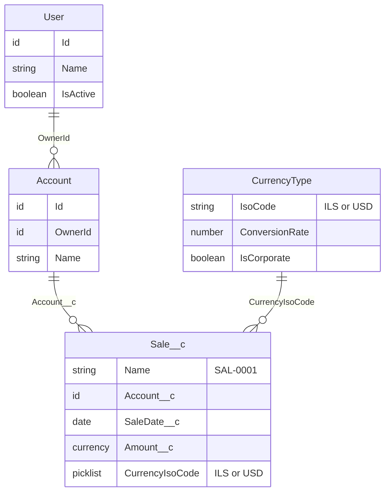
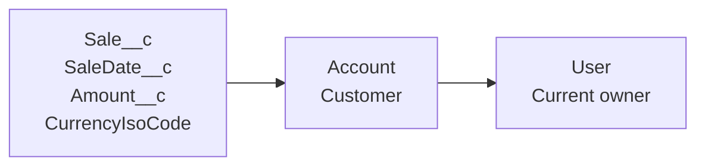
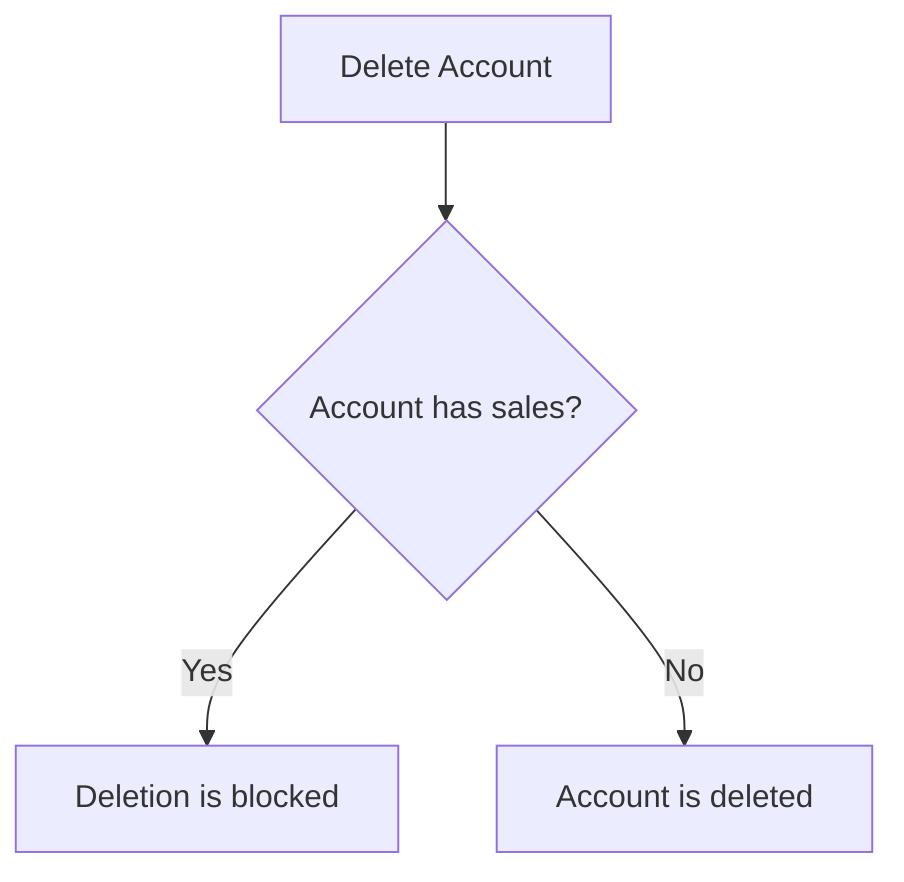
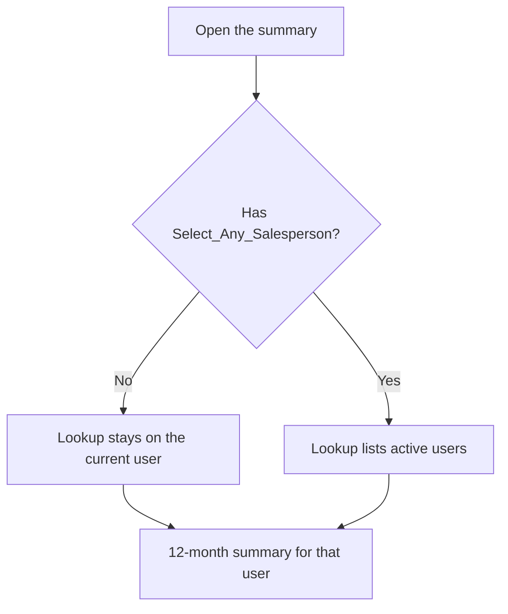
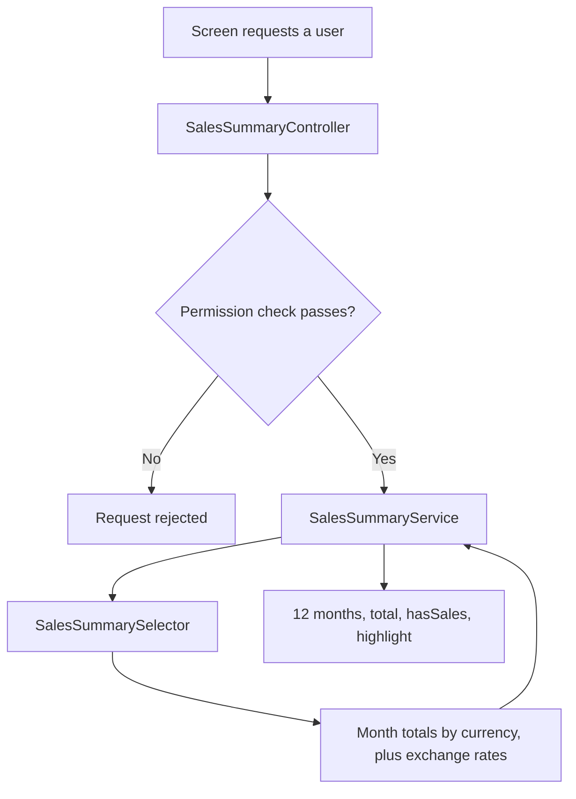

# Monthly Sales Summary — Plan

Source: [monthly-sales-summary-requirements.md](./monthly-sales-summary-requirements.md)

Tests: [monthly-sales-summary-test-plan.md](./monthly-sales-summary-test-plan.md)

All five modules are locked.

| # | Module | Status |
| --- | --- | --- |
| 1 | Data model | Planned |
| 2 | Permissions | Planned |
| 3 | Summary service | Planned |
| 4 | Screen | Planned |
| 5 | Handoff | Planned |

## Module 1 — Data model

**Status:** Planned

### Decision

A sale is a `Sale__c` record, linked to the customer (`Account`) by a required Lookup.

The salesperson is the current Account owner. The sale stores the customer, the date, the amount, and the currency the amount was entered in.

### Diagrams

A sale belongs to one customer. A customer belongs to one current owner. One currency type covers many sales.



The summary reads the salesperson from the Account at query time. The sale has no salesperson field. `Sale__c` has its own Owner for access, and that owner is not the credited salesperson.



Deleting an Account is blocked while any sale still points at it. The sales stay.



### Object

| Setting | Value |
| --- | --- |
| Label | Sale |
| Plural label | Sales |
| API name | `Sale__c` |
| Record name | Auto-number `SAL-{0000}`, starting at 1 |
| Account link | Required Lookup to Account |
| Child relationship name | `Sales` (Apex: `Sales__r`) |
| If Account is deleted | Don't allow deletion of the lookup record that's part of a lookup relationship |
| Sharing | Private. The sale has its own Owner. `Sales_Manager` has View All Records. The summary query runs without sharing after the permission check. |
| Reparent | Yes. Edit `Account__c` to move a sale to the correct customer. |
| Allow reports | Yes |
| Allow activities | No |
| Track field history | No |

### Fields

| Label | API name | Type | Required | Notes |
| --- | --- | --- | --- | --- |
| Account | `Account__c` | Lookup (Account) | Yes | The customer this sale belongs to. Deleting that Account is blocked while this sale exists. |
| Sale Date | `SaleDate__c` | Date | Yes | Places the sale in a calendar month. |
| Amount | `Amount__c` | Currency (16, 2) | Yes | Stored in the sale's own currency. |
| Amount Number | `AmountNumber__c` | Number (16, 2), formula | No | Equals `Amount__c`. The grouped query sums this so the total stays in the sale currency. |
| Currency | `CurrencyIsoCode` | Picklist (standard) | Yes | Added by multi-currency. Values used here: `ILS`, `USD`. |

`CurrencyIsoCode` is a standard field. We do not create a second currency field.

### What this object does not store

- A salesperson lookup. The salesperson is `Account.OwnerId` at the time the summary is calculated. After an Account changes owner, later summaries follow the new owner.
- A frozen exchange rate or a frozen ILS amount. Conversion uses the current static rate.
- A monthly total. Month totals are calculated when the summary is requested.
- Opportunity, stage, or forecast data.

### Org currency setup

This object depends on Salesforce multi-currency.

- Active currencies include `ILS` and `USD`.
- Each sale is saved with `CurrencyIsoCode` of `ILS` or `USD`.
- Confirm the org's corporate currency before building. Leave it as it is if it is already set. The summary still converts totals to ILS in the summary service.

Dated exchange rates apply to opportunities. This object uses the static rate on Currency Type.

### Page layout

One section, Information:

- Sale Date
- Amount
- Currency
- Account

### How to find the records

- Related list **Sales** on the Account page layout.
- A **Sales** tab for creating and searching sale records. `Sales_Summary_User` and `Sales_Manager` can see it.

### Validation

One validation rule, `Currency_Is_ILS_Or_USD`: `CurrencyIsoCode` must be `ILS` or `USD`. A sale cannot be saved in any other active currency.

No other validation rules. The brief does not limit the sign of the amount or how far in the future a sale date may be.

### Assumptions

- The screen shows month totals in ILS. Each sale is converted from its stored currency with the org's current static exchange rate, then summed.
- A change to that rate changes the ILS total of past months. The sale does not store a frozen rate or a frozen ILS amount.
- The red highlight compares the rounded ILS month total with Custom Label `Sales_Summary_Low_Amount`, shipped as `1000`. A later requirement may change that number.
- Zero and positive amounts are valid. Negative amounts are left allowed because the brief does not forbid them.

### Continued in later modules

- Who can see a sale, who can see the tabs, and who can change the lookup are defined in Module 2.
- The 12-month query and currency conversion are defined in Module 3. The test cases are in the test plan.
- The lookup, table, red amounts, total, and empty-state toast are defined in Module 4.
- Team access, the Setup map, and the written assumptions are defined in Module 5.

## Module 2 — Permissions

**Status:** Planned

### Decision

Two permission sets and one custom permission. No new profiles.

The screen's lookup and the Apex that serves it both check the same custom permission. A salesperson stays on the current user. A sales manager can select any active user.



### Custom permission

| Setting | Value |
| --- | --- |
| Label | Select Any Salesperson |
| API name | `Select_Any_Salesperson` |
| Purpose | Allows the summary to be loaded for a user other than the current user |

A System Administrator does not receive a custom permission from the profile. Admins who use the lookup are assigned `Sales_Manager` as well. That assignment is done in the handoff.

### Permission sets

Every person who uses the screen gets `Sales_Summary_User`. Managers get `Sales_Manager` in addition.

| | `Sales_Summary_User` | `Sales_Manager` |
| --- | --- | --- |
| Who | Salesperson | Sales manager |
| Custom permission | — | `Select_Any_Salesperson` |
| `Sale__c` | Read, Create, Edit | View All Records |
| `Sale__c` fields | Read and edit `Account__c`, `SaleDate__c`, `Amount__c`, `CurrencyIsoCode` | Field access comes from `Sales_Summary_User` |
| Account | Read | View All Records |
| Users | — | View All Users, so the lookup can find any active user |
| Sales tab and Sales Summary tab | Visible | Visible |
| Apex class | `SalesSummaryController` | `SalesSummaryController` |

These sets do not grant Delete on `Sale__c` or on Account. Deleting an Account that still has sales stays blocked by the lookup from Module 1.

Permission sets add access. They cannot remove access a profile already grants. Assign these sets to users whose profile does not already include View All on Sale, Account, or Users.

### What the screen does

- The lookup defaults to the current user.
- With `Select_Any_Salesperson`, the lookup is editable and shows active users only.
- Without it, the lookup stays on the current user and cannot be changed.

### What Apex does

The UI check is not enough. The summary action repeats it.

1. A null id, an unknown id, or an inactive id is rejected with "Select an active user."
2. Without `Select_Any_Salesperson`, any other id than the running user is rejected with "You can only view your own sales summary."
3. Only after those checks, load the 12-month summary.

The credited salesperson is the Account owner, while each sale has its own record owner. The aggregate query runs in a `without sharing` selector so a salesperson sees every sale on accounts they own, and a manager sees the salesperson they selected. Field-level security still applies by reading the fields in user mode. The selector is called only after the check above. The cases for this check are in the test plan.

## Module 3 — Summary service

**Status:** Planned

### Decision

One Apex action returns the 12-month summary for one salesperson. The screen does not add, convert, or decide the red highlight itself.

The current month comes from the organization timezone, so every user sees the same 12 months. Month names are always English. Each month is rounded to 2 decimal places, and the total is the sum of those 12 amounts. The red-highlight threshold is the Custom Label `Sales_Summary_Low_Amount`, shipped as `1000`.



### Custom label

| Setting | Value |
| --- | --- |
| Label | Sales Summary Low Amount |
| API name | `Sales_Summary_Low_Amount` |
| Value | `1000` |
| Meaning | A month that had sales, with an ILS total below this number, is highlighted |

A later requirement can change this number without an Apex change. The comparison stays “below this number.” A month of exactly `1000.00` is not highlighted.

### Classes

| Class | Sharing | Job |
| --- | --- | --- |
| `SalesSummaryController` | `with sharing` | AuraEnabled entry. Runs the Module 2 permission check, then calls the service. |
| `SalesSummaryService` | `with sharing` | Builds the 12 months, converts to ILS, rounds, and applies the label. |
| `SalesSummarySelector` | `without sharing` | Reads grouped sales and currency rates. Called only after the permission check. |

The result types live inside `SalesSummaryService`. The permission sets grant access to `SalesSummaryController`.

### Result

| Field | Meaning |
| --- | --- |
| `hasSales` | False when the salesperson has no sales in the window. The screen then shows a toast. |
| `currencyCode` | `ILS` or `USD`. The screen default is NIS, which is `ILS`. |
| `total` | Sum of the 12 rounded month amounts. |
| `months` | Empty when `hasSales` is false. Otherwise 12 rows, oldest first, current month last. |

Each month has:

| Field | Meaning |
| --- | --- |
| `name` | English month name: January through December. |
| `year` | Calendar year. |
| `amount` | ILS total, rounded half up to 2 decimal places. `0.00` when the month has no sales. |
| `hasSales` | True when at least one sale falls in that month. |
| `highlight` | True when `hasSales` is true and `amount` is below `Sales_Summary_Low_Amount`. |

### Window and names

“Today” is the current date in the organization’s timezone (`Organization.TimeZoneSidKey`), not the timezone of the person who opened the screen.

The window is the current calendar month plus the 11 months before it. `SaleDate__c` is included from the first day of the oldest month through the last day of the current month.

Month names come from a fixed English list. They do not follow the running user’s language.

The service resolves the organization date, then builds the months from that date.

### Query

One aggregate query, for the selected user and the date window:

- Filter `Account__r.OwnerId` to that user.
- Group by calendar year, calendar month, and `CurrencyIsoCode`.
- Sum `AmountNumber__c`.

`AmountNumber__c` is a number formula equal to `Amount__c`. A grouped `SUM` of the currency field itself is returned in the corporate currency, already rounded, so the summary sums the number and converts that result.

A second query reads `CurrencyType` for `IsoCode` and `ConversionRate`. The rate means 1 unit of the corporate currency equals `ConversionRate` units of that currency. For each group:

`amount in ILS = group sum × (ILS rate ÷ sale currency rate)`

Groups in the same month are added, then that month is rounded half up to 2 decimal places. `convertCurrency()` is not used, because it converts into the running user’s currency, and this total is ILS for every viewer.

Thousands of sales stay in that one grouped query. The date filter keeps older years out of the scan. No per-sale queries and no summary records.

The selector reads in user mode, so field permissions still apply.

### Call contract

- The action is not cacheable. Opening the screen reads the current sales.
- Rejection throws an `AuraHandledException`. It does not return `hasSales` false. That flag means the 12-month window contains no sales.
- A null id, an unknown id, or an inactive id returns "Select an active user."
- Without `Select_Any_Salesperson`, any other id than the running user returns "You can only view your own sales summary."

## Module 4 — Screen

**Status:** Planned

### Decision

One Lightning web component, `salesSummary`, on a **Sales Summary** tab in the Sales app. It calls `SalesSummaryController` and renders that payload. It does not convert currency, choose the 12 months, or decide which amount is red.

```mermaid
flowchart TD
    open["Open Sales Summary"] --> call["Load the selected user"]
    call --> waiting["Spinner"]
    waiting --> result{"Result"}
    result -->|hasSales| table["Table and total"]
    result -->|no sales| empty["Info toast, no table"]
    result -->|rejected| error["Error toast, no table"]
```

### Where it lives

| Piece | Value |
| --- | --- |
| Component | `salesSummary` |
| Page | Lightning App Page `Sales_Summary` |
| Tab | Sales Summary |
| App | Sales |
| Who sees the tab | `Sales_Summary_User` |

### Standard components

- `lightning-card` wraps the screen. The title is Sales Summary.
- `lightning-record-picker` on User is the salesperson lookup.
- `lightning-radio-group` switches the summary between NIS and USD.
- `lightning-datatable` is the 12-month table.
- `lightning-formatted-number` shows the total under the table.
- `lightning-spinner` shows while the summary is loading.
- `ShowToastEvent` is the toast.

The red amount uses the SLDS class `slds-text-color_error` on that cell. No custom color is defined.

### Lookup

- The label is Salesperson.
- The value starts as the current user, and the summary loads for that user.
- The picker lists active users only (`IsActive` equals true).
- With `Select_Any_Salesperson`, the picker is editable. Changing the user loads that summary.
- Without it, the picker stays on the current user and is disabled.
- Clearing the picker does not call Apex and does not show the empty-sales toast.

The component reads the custom permission with `@salesforce/customPermission/Select_Any_Salesperson`. Apex still rejects a user the running user is not allowed to view.

### Currency

The currency switch starts on NIS. NIS is sent as `ILS`. USD is the other choice. Changing it reloads the summary for the selected user. Amounts are converted into that currency, then each month is rounded. The red highlight still compares the rounded ILS total with `Sales_Summary_Low_Amount`, so the same months stay red when the screen shows USD.

### Table

Shown only when `hasSales` is true.

| Column | Source | Display |
| --- | --- | --- |
| Month | `name` | Text |
| Year | `year` | Text, so the year is not grouped as a thousands number |
| Amount | `amount` | Currency, NIS (`ILS`) or USD, from the currency switch |

When `highlight` is true, the Amount cell is red. The month name and the year stay in the normal color. A `0.00` month is not red, because the service sets `highlight` only when that month had sales under the label.

The rows stay in the order the service returns: oldest month first, current month last. While a request is in flight, the table is hidden, so a previous salesperson's rows cannot sit under the newly selected name.

### Total

Under the table, the label Total and the `total` field, formatted in the selected currency. It is hidden when the table is hidden. The total is never red, including when it is below `Sales_Summary_Low_Amount`.

### Toasts

| Situation | Toast | Table |
| --- | --- | --- |
| `hasSales` is false | Info: "No sales in the last 12 months." | Hidden |
| Apex rejects the request | Error, with the `AuraHandledException` message | Hidden |

A rejected request does not use the empty-sales toast. Only the latest request is applied, so a slow response for a previous user cannot replace the current one.

## Module 5 — Handoff

**Status:** Ready

### Decision

The team receives a Salesforce DX repository. It contains the metadata, the requirements, this plan, and the test plan. `HANDOFF.md` is added when the metadata has been deployed. It maps every built piece to a place in Setup and states the business assumptions. The repository does not add product features beyond the plan.

Each guideline is met like this:

| Guideline | How |
| --- | --- |
| Design and build the data structure | `Sale__c` metadata in the repository |
| A test class for every Apex class | The three test classes in the repository. The team runs them with the Salesforce CLI. |
| Use standard components | The screen in Module 4 |
| Grant System Administrator access to the team | `scripts/review-admin.apex` creates Review Administrator on the shared org. The username and password are in `HANDOFF.md`. |
| Document what was built and where to find it | `README.md` for deploy and test commands. `HANDOFF.md` for the Setup map. |
| State business assumptions | `HANDOFF.md`, copied from the list below |

### Repository

| Path | Contents |
| --- | --- |
| `force-app/` | Sale object, permission sets, custom permission, custom label, Apex, Lightning component, app page, and tab |
| `docs/` | The requirements, this plan, and the test plan |
| `scripts/seed.apex` | Sample customers and sales so the screen can be clicked |
| `README.md` | Deploy, assign permission sets, run the Apex tests, open Sales Summary |
| `HANDOFF.md` | Written after the first deploy, with the org's corporate currency |

### Runnable for the team

The target org is the Developer Edition authorized on this machine.

| | |
| --- | --- |
| Alias | `dev-edition` |
| Username | `nadav.gilron.e1572ad0756b@agentforce.com` |
| Org ID | `00DjV000008CSTlUAO` |
| CLI | `@salesforce/cli/2.157.8` |

Multi-currency is on. `USD` is the corporate currency, with conversion rate `1`. `ILS` is active, with conversion rate `3.18` (1 USD = 3.18 ILS). Advanced Currency Management is off. These rates stay as they are. Deploy does not change them.

After deploy, each team member assigns `Sales_Summary_User` and `Sales_Manager` to their own System Administrator user, then runs `scripts/seed.apex` as that user. The seed creates sales on accounts they own, in both currencies, including a month below `1000` ILS and a month above it. Opening Sales Summary shows their table. The Apex tests create their own users and data, so they also pass on an org where the seed has not been run.

### Access

On the shared org, the reviewing team signs in as Review Administrator. The username and password are in `HANDOFF.md`. The email is the running user's email. A guessed reviewer address is not used.

A System Administrator still needs `Sales_Manager` to change the salesperson lookup, because the profile does not include `Select_Any_Salesperson`. Those admin users are assigned `Sales_Summary_User` and `Sales_Manager`.

Salespeople receive `Sales_Summary_User` only. Sales managers receive both permission sets.

### Where to find the development

| What was built | Where it is in the org |
| --- | --- |
| Sale object, fields, auto-number | Setup → Object Manager → Sale |
| Currency rule | Sale → Validation Rules → `Currency_Is_ILS_Or_USD` |
| Sales on a customer | Account page layout → Sales related list, and the Sales tab |
| Summary screen | Sales app → Sales Summary tab |
| Who can open it | Setup → Permission Sets → `Sales_Summary_User` |
| Who can change the lookup | Setup → Permission Sets → `Sales_Manager` |
| Lookup permission | Setup → Custom Permissions → Select Any Salesperson |
| Red-amount threshold | Setup → Custom Labels → Sales Summary Low Amount (`1000`) |
| Summary logic | Apex classes `SalesSummaryController`, `SalesSummaryService`, `SalesSummarySelector` |
| Test classes | Listed in the test plan |
| Screen | Lightning component `salesSummary`, App Page `Sales_Summary` |

An empty org shows the toast "No sales in the last 12 months." Sale records have to be created before the table appears.

### Org checklist

Before the screen is used:

- Multi-currency is on. `ILS` and `USD` are active.
- The corporate currency is recorded in `HANDOFF.md` and left as it is. Totals are still converted to ILS.
- `Sales_Summary_Low_Amount` is `1000`.

### Assumptions stated in the handoff

- A sale belongs to the customer's current Account owner, including after an owner change.
- Month totals are shown in NIS or USD, chosen on the screen. NIS is the default. Each sale is converted with the current static exchange rate. A later rate change updates past months. A month is red from its ILS total, including when the screen shows USD.
- The 12 months follow the organization timezone. Month names are English.
- Each month is rounded half up to 2 decimal places. The total is the sum of those 12 amounts.
- A month is red only when it had sales and its rounded amount is below `Sales_Summary_Low_Amount`. The total is never red.
- No sales in the window shows a toast and no table.
- Negative amounts are allowed and are included in the month total.
- Deleting an Account that still has sales is blocked. The sales stay.
- A salesperson sees only their own summary. A sales manager can select any active user.

The checks the team runs in the org are in the test plan.
